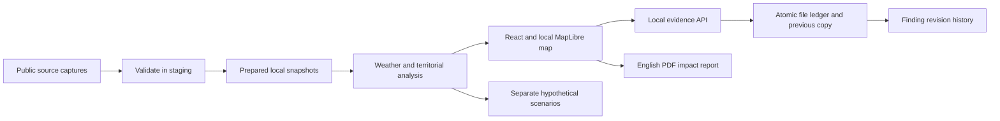

# System architecture

The beta runs on one computer. Vite serves React, local JSON data and a small same-origin evidence API. No cloud account, generative model service or database daemon is required.

## Components

- `src/city/analysis.js`: meteorological checks, watch index, verification validation and evaluation rules.
- `territory.js`, `areas.json`: search, official quadrant navigation, complete polygon membership and honest neighboring-canton context.
- `findings.js`: event/area findings, transitions and isolated scenario calculations.
- `CityMap.jsx`: local prepared style, local labels, progressive detail and optional online streets.
- `FindingsPanel.jsx`, `ScenarioExplorer.jsx`, `EventWalkthrough.jsx`: plain-language interaction.
- `impact-report.js`: eight report sections and paginated PDF output through jsPDF; code is loaded on demand.
- `vite.config.js` and `scripts/local-ledger.mjs`: local `/api/ledger`, checked evidence, optimistic revision control, serialized atomic writes and retained previous file. The API binds only through the loopback Vite server. It is not a production authentication service.
- `data-local/ledger.json`: records and append-only finding revisions. Browser storage is only a fallback/cache; a failed disk save is reported explicitly. Two sessions cannot silently overwrite each other.
- `validate-demo.mjs` and `update-local-data.mjs`: source/assessment integrity checks, staging validation, previous-version retention and failure rollback. Immutable raw forecast captures are separate from published prepared data.

The SQLite file is a portable historical query copy. The active UI uses JSON snapshots and the local ledger; automatic SQLite synchronization after a forecast update is not claimed. The preserved laboratory has its own worker and synthetic session data. No hypothetical scenario writes to the real evidence ledger.
